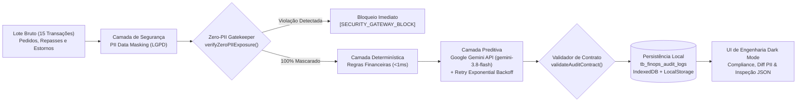

# FinGuard AI — Conciliação Financeira, PII Masking & Detecção de Fraudes com IA

Painel de **Engenharia Financeira (FinOps), Cybersecurity (LGPD / PCI-DSS) e Prevenção a Fraudes** projetado para plataformas de Delivery de alta escala. O sistema processa lotes de transações financeiras (pedidos, repasses a restaurantes e solicitações de estorno/reembolso), aplicando **sanitização determinística de dados sensíveis (PII Data Masking)** antes de qualquer inferência externa, combinando **validação determinística de regras de negócio** com **análise preditiva via Google Gemini API (`gemini-3.8-flash` — Structured Outputs / JSON Schema)** e persistência auditável local (`tb_finops_audit_logs`).

---

## 1. Arquitetura de Segurança & Fluxo Neuro-Simbólico



### Estrutura Modular do Projeto

```text
finops-fraud-guardian-ai/
├── index.html                        # Interface de Engenharia Financeira (Dark Mode #0D1117 / #161B22)
├── server.js                         # Servidor Full-Stack Node.js + Endpoints REST (/api/audit/batch)
├── package.json                      # Scripts e configuração ES Modules (@google/genai >= 2.3.0)
├── README.md                         # Documentação técnica de arquitetura, segurança e JSON Schema
├── src/
│   ├── domain/
│   │   ├── models.js                 # Enums, JSON Schema estrito, System Instruction e Validador
│   │   ├── mockTransactions.js       # Lote inicial de 15 transações de delivery (normais e ataques)
│   │   └── deterministicRules.js     # Motor determinístico (duplicidade no mesmo minuto, limites rígidos)
│   ├── services/
│   │   ├── piiMasker.js              # Sanitização LGPD/PCI-DSS (CPF, E-mail, PAN, Telefone, Texto Livre)
│   │   ├── retryWithBackoff.js       # Resiliência: Retry Pattern com Exponential Backoff + Full Jitter
│   │   ├── geminiFraudService.js     # Integração Google Gemini Interactions API (Structured Outputs)
│   │   └── finopsPipelineService.js  # Orquestrador do pipeline e cálculo de métricas de compliance
│   ├── storage/
│   │   └── auditRepository.js        # Persistência IndexedDB + LocalStorage simulando tb_finops_audit_logs
│   └── ui/
│       ├── styles.css                # Tema técnico Dark Mode (#0D1117, #161B22, #3FB950, #F85149)
│       ├── components.js             # Renderizadores puros de KPIs, Diff PII, Tabela e Modal <dialog>
│       └── app.js                    # Controlador de estado, filtros, injeção de ataques e eventos
└── tests/
    └── run-tests.js                  # Suíte de testes automatizados End-to-End
```

---

## 2. Camada de Ingestão & PII Data Masking (LGPD Art. 46 / PCI-DSS)

Implementada em [`src/services/piiMasker.js`](./src/services/piiMasker.js), a camada de sanitização atua como um **Zero-Trust AI Gateway**. Nenhum dado pessoal sensível bruto jamais atravessa a fronteira de rede para o provedor de IA:

| Atributo Sensível | Valor Bruto (Entrada) | Valor Sanitizado (Saída para IA) | Técnica de Engenharia |
| :--- | :--- | :--- | :--- |
| **CPF (`customer_cpf`)** | `348.712.905-44` | `***.712.905-**` | Redação parcial + Hash `FNV-1a` (`cpf_correlation_hash`) |
| **E-mail (`customer_email`)** | `carlos.mendonca88@gmail.com` | `ca***88@gm***.com` | Mascaramento de parte local e domínio |
| **Cartão (`card_number`)** | `4532 8810 3392 7104` | `**** **** **** 7104` | Truncamento PCI-DSS (apenas 4 últimos dígitos + `card_correlation_hash`) |
| **Telefone (`customer_phone`)** | `(11) 98741-2230` | `(11) *****-2230` | Supressão de prefixo móvel |
| **Nome (`customer_name`)** | `Carlos Eduardo Mendonça` | `Carlos E. ***` | Pseudonimização de sobrenome |
| **Notas (`customer_notes`)** | `...CPF 348.712.905-44...` | `...CPF ***.712.905-**...` | Deep Regex Free-Text Sanitizer |

> **Preservação de Correlação Anti-Fraude sem Expor PII**: Para que a Camada Determinística e o modelo Gemini consigam detectar ataques de múltiplas contas (*Sybil Farming*) ou *Replay Attacks* sem conhecer o CPF ou o cartão real, o `piiMasker.js` gera tokens determinísticos unidirecionais (`cpf_correlation_hash: "id_cpf_..."` e `card_correlation_hash: "id_pan_..."`).
> Além disso, a função `verifyZeroPIIExposure()` inspeciona a string JSON serializada antes do envio e aborta imediatamente a transação caso qualquer padrão de CPF aberto, PAN de 16 dígitos ou e-mail não mascarado seja detectado.

---

## 3. Camada Determinística (Regras de Negócio Financeiras)

Implementada em [`src/domain/deterministicRules.js`](./src/domain/deterministicRules.js), executa 4 políticas rígidas sobre o lote sanitizado antes da inferência da IA:

1. **`RULE_SAME_MINUTE_DUPLICATE`**: Detecta transações concorrentes do mesmo pedido (`order_id`) ou mesmo titular/valor submetidas dentro da mesma janela de minuto (`YYYY-MM-DDTHH:mm` ou intervalo $\le 60\text{s}$), como ocorre no par `TXN-2026-9002` / `TXN-2026-9003`.
2. **`RULE_HARD_REFUND_LIMIT_EXCEEDED` & `RULE_REFUND_EXCEEDS_ORIGINAL_ORDER`**: Impõe o teto rígido de reembolso automático (`R$ 350,00`) e bloqueia imediatamente qualquer tentativa de estorno cujo valor supere o valor bruto original do pedido (`refund_amount_brl > gross_amount_brl`, ex: `TXN-2026-9007`).
3. **`RULE_EXCESSIVE_COUPON_DISCOUNT` & `RULE_SINGLE_USE_COUPON_SYBIL_REPLAY`**: Identifica descontos promocionais acima do limite de política (`> 55%` do valor do pedido) e reutilização fraudulenta de cupons de uso único (`PRIMEIRACOMPRA80`) através do mesmo `device_fingerprint`, `ip_address` ou `card_correlation_hash` (`TXN-2026-9004` e `TXN-2026-9005`).
4. **`RULE_PAYOUT_EXCEEDS_GROSS_GMV` & `RULE_MERCHANT_COMMISSION_UNDERFLOW`**: Audita repasses a restaurantes (`MERCHANT_PAYOUT`) onde o valor líquido de liquidação supera o faturamento bruto (`TXN-2026-9009`) ou retém comissão da plataforma inferior ao piso contratual mínimo de `12%` (`TXN-2026-9014`).

---

## 4. Contrato JSON Schema Estrito (Google Gemini API Structured Outputs)

Definido em [`src/domain/models.js`](./src/domain/models.js) e integrado em [`src/services/geminiFraudService.js`](./src/services/geminiFraudService.js) utilizando o modelo atual `gemini-3.8-flash` via **Interactions API** (`v1beta/interactions`) com `response_format`:

```json
{
  "type": "object",
  "properties": {
    "fraud_score": {
      "type": "number",
      "description": "Score contínuo de risco de fraude de 0.0 (risco nulo) a 100.0 (fraude crítica confirmada)."
    },
    "anomaly_classification": {
      "type": "string",
      "enum": [
        "NORMAL",
        "SUSPICIOUS_REFUND_DUPLICATION",
        "COUPON_ABUSE",
        "MERCHANT_DISCREPANCY",
        "CRITICAL_FRAUD"
      ]
    },
    "recommended_action": {
      "type": "string",
      "enum": [
        "APPROVE",
        "HOLD_FOR_AUDIT",
        "AUTOMATIC_BLOCK",
        "MANUAL_REVIEW"
      ]
    },
    "risk_indicators": {
      "type": "array",
      "items": { "type": "string" }
    },
    "explainability_report": {
      "type": "string",
      "description": "Relatório de auditoria técnica em português."
    }
  },
  "required": [
    "fraud_score",
    "anomaly_classification",
    "recommended_action",
    "risk_indicators",
    "explainability_report"
  ],
  "additionalProperties": false
}
```

### Resiliência Backend (Retry Pattern com Exponential Backoff + Jitter)

O módulo [`src/services/retryWithBackoff.js`](./src/services/retryWithBackoff.js) encapsula todas as chamadas de inferência com `executeWithRetry()`, tratando falhas transientes (`HTTP 429 Rate Limit`, `502/503/504`, timeouts de rede ou falhas eventuais de validação do schema JSON) com espera exponencial:

$$t_{\text{delay}} = \min\left(t_{\max},\; t_{\text{base}} \cdot 2^{\text{attempt}-1} + \text{Jitter}\right)$$

---

## 5. Persistência Local & Auditoria (`tb_finops_audit_logs`)

Implementada em [`src/storage/auditRepository.js`](./src/storage/auditRepository.js), grava cada transação processada no **IndexedDB** (`FinGuardAuditDB` $\rightarrow$ Object Store `tb_finops_audit_logs` com índices secundários por classificação, ação e score) e mantém espelhamento síncrono no **LocalStorage** (`finguard_tb_finops_audit_logs_v1`), permitindo exportação tanto em `.json` quanto em instruções SQL `CREATE TABLE` / `INSERT INTO tb_finops_audit_logs`.

---

## 6. Como Executar e Testar

### Executar a Suíte de Testes Automatizados

```bash
npm test
```

### Iniciar o Servidor Full-Stack

```bash
npm start
```

Acesse `http://localhost:3000` no navegador (ou abra `index.html` via servidor local).
- Para usar o motor **Live Google Gemini API (`gemini-3.8-flash`)**, insira sua chave `GEMINI_API_KEY` no campo superior da interface (ou defina a variável de ambiente `GEMINI_API_KEY`).
- Sem chave configurada, o sistema opera automaticamente com o **Gemini Structured Twin Engine**, processando as 15 transações em tempo real com 100% de aderência ao contrato JSON Schema.
